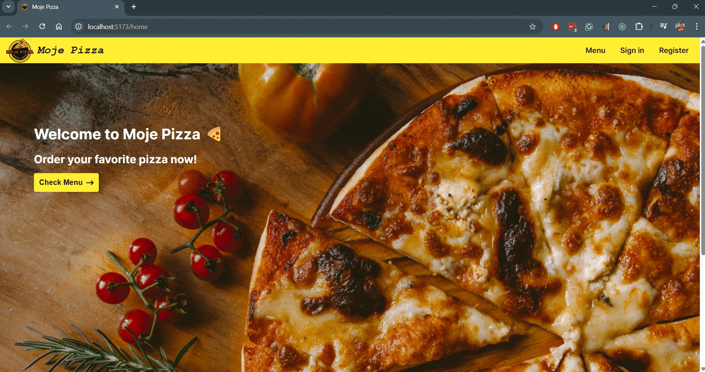
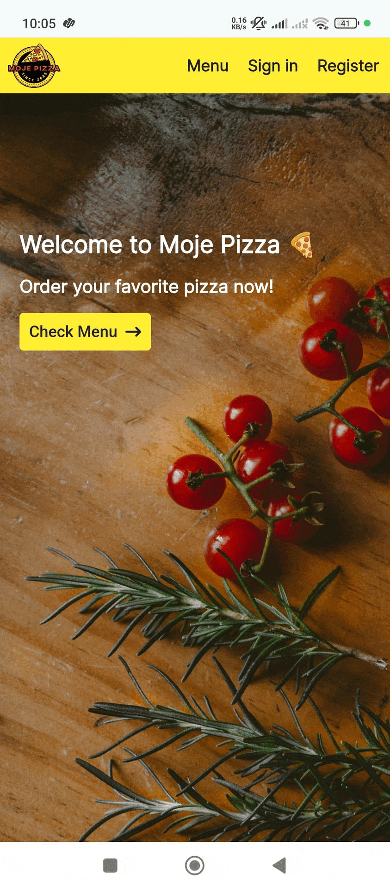
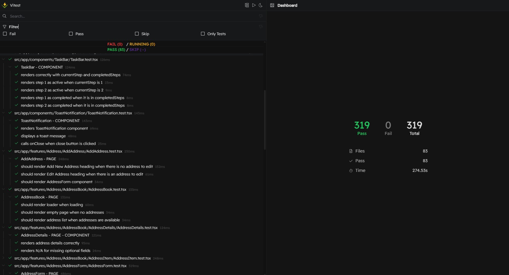
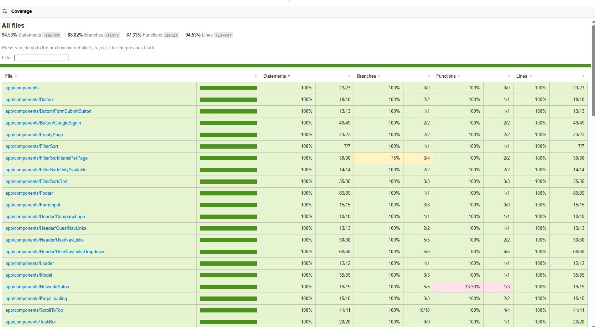

# 🍕 Moje Pizza - Online Pizza Ordering Platform

This repository serves as a portfolio project which showcases my expertise in frontend development with **React**, **TypeScript**, and **Vite**, along with state management using **Redux Toolkit**, data fetching with **React Query**, testing using **Vitest**, and backend integration via **Supabase**.

## Table of Contents

- [Project & Overview](#project-overview)
- [Live Demo](#live-demo)
- [App Screenshots](#app-screenshots)
- [Important Note](#important-note)
- [Features](#features)
- [Tech Stack & Tools](#tech-stack--tools)
- [Project Structure](#project-structure)
- [Code Quality & Best Practices](#code-quality--best-practices)
- [Test Results](#test-results)
- [License](#license)

## Project Overview

**Moje Pizza** is a full-stack pizza ordering web application built with modern web technologies, featuring real-world e-commerce functionality with robust backend integration and comprehensive testing with **91%+ test coverage**.

This project is built using **React, TypeScript, and Vite**, with backend integration powered by **Supabase**. It offers a smooth and intuitive user experience, including user authentication, a shopping cart, an order management system, and advanced filtering features. The project follows best practices with **300+ automated tests** written using **Vitest**, ensuring robustness and reliability.

## Live Demo

Check out the live demo here: [Moje Pizza Demo](https://moje-pizza.netlify.app)

## App Screenshots

## Important Note

- No **`.env`** file is included in the repository to maintain security.
- Supabase database is pre-configured, so authentication and data fetching will not work in a local environment without proper credentials.

## Features

- **User Authentication**  - Secure `signup`/`signin` using Supabase Email Authentication.
- **Menu Management** - Dynamic pizza menu with filtering, sorting, and pagination
- **Shopping Cart** - Persistent cart functionality with coupon code support
- **Address Book** - CRUD operations for customer addresses with phone validation
- **Order Management** - Order history tracking with sorting (newest/oldest)
- **Checkout System** - Complete order preparation flow (payment integration placeholder)
- **Custom Toast Notifications** - For Success, Errors, and Info messages
- **Lazy Loading & Memoization** - For optimized performance
- **Protected Routes** - Access control for authenticated users
- **Quality Assurance** – 300+ automated tests with **91%+ coverage** across components, hooks, slices, and services
- **Fully Responsive Design** - Optimized for all devices

## Tech Stack & Tools

### Frontend

- [React 18.3](https://reactjs.org/) with [TypeScript](https://www.typescriptlang.org/)
- [Vite](https://vitejs.dev/) for build tooling
- [React Router v7.1](https://reactrouter.com/) for routing
- [Redux Toolkit + React-Redux](https://redux-toolkit.js.org/) for state management
- [React Query v4](https://react-query.tanstack.com/) for data fetching
- [React Hook Form](https://react-hook-form.com/) for form management

### Testing

- [Vitest](https://vitest.dev/) for unit and integration testing
- [@testing-library/react](https://testing-library.com/docs/react-testing-library/intro/) for component testing
- [@testing-library/jest-dom](https://github.com/testing-library/jest-dom) for DOM assertions
- Redux Mock Store for testing Redux Store integration
- Test coverage: Components, Hooks, Redux Slices, Routes, Services, Supabase API's, Utility functions

### Backend Integration

- [Supabase](https://supabase.io/) for backend services and database management (Auth, Database, Storage)
- Supabase JavaScript Client

### UI/UX

- [CSS Modules](https://github.com/css-modules/css-modules) for scoped styling
- Responsive Layouts
- React Icons
- Phone Number Validation (libphonenumber-js)

## Project Structure

This project is organized with a **feature-oriented modular architecture**, designed for scalability, maintainability, and collaboration.

All application logic lives under `src/app`, ensuring a clear separation between **UI components, feature modules,** and **shared business logic**:

- **`app/components/`** → Reusable UI primitives (e.g. `Button`, `Modal`, `Loader`).
- **`app/features/`** → Self-contained feature modules (e.g. cart, order, checkout, address). Each feature owns its **components, hooks, services, and Redux slice**, which makes features easy to extend or replace.
- **`app/shared/`** → Cross-feature domain logic (e.g. `AddressBook`, `useAuth`, `apiClient`, types) that can be reused across multiple features without duplication.
- **`app/layouts/`** → Application and customer layouts.
- **`app/pages/`** → Route-level pages such as `Home`, `NotFound`.
- **`app/hooks/`** → Generic reusable hooks.
- **`app/services/`** → External services (e.g. Supabase, API clients).
- **`app/store/`** → Redux store setup and global slices.
- **`app/utils/`** → Utility functions and helpers.
- **`app/routes/`** → Route definitions.

Outside of `app/`, only static assets (`/assets`) are stored at the top level.

## Code Quality & Best Practices

- **Scalable Architecture:** feature-oriented modular architecture for easy expansion
- **Thoroughly Tested:** 91%+ test coverage
- **Optimized Performance:** Lazy loading, memoization, and efficient state updates
- **Type Safety:** Strong TypeScript integration
- **Clean & Maintainable Code:** Following best practices for React, Redux, and React Query

## Test Results

 

## ⭐ Feedback & Contributions

This repository is for showcasing my code rather than open-source contributions.  I do not accept any contributions like pull requests to this project. However, feedback and suggestions are always welcome!

If you have any thoughts, feel free to reach out.

## License

This codebase is intended exclusively for **portfolio and evaluation purposes** by potential employers.

**use, modify, distribute, or commercialize** the code in this repository **for any purpose** is **strictly prohibited**.  

By accessing this repository, you **agree** to these terms.  

See the [LICENSE](./LICENSE.txt) file for more details.
